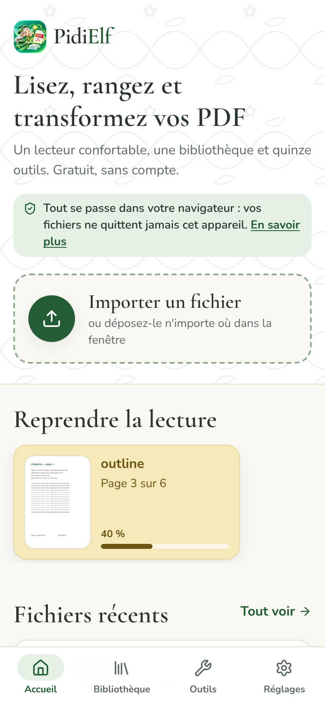
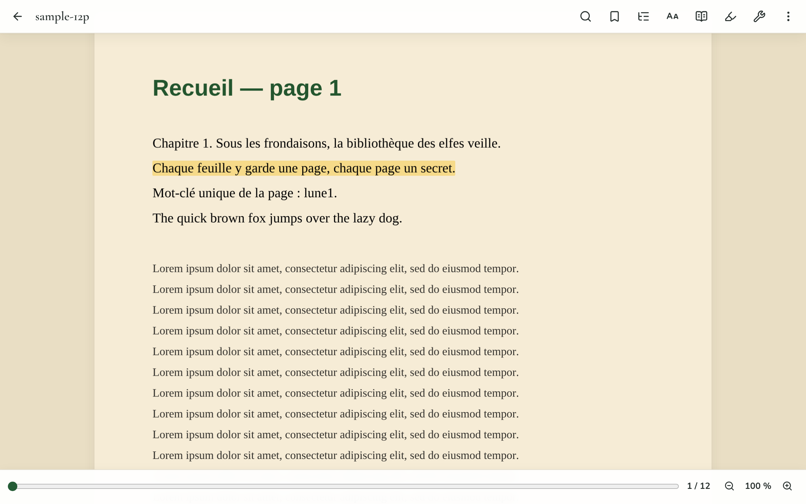
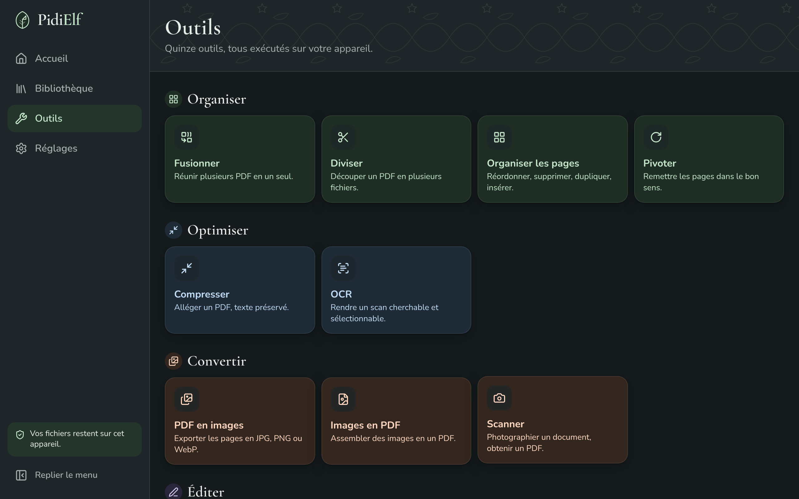

# PidiElf

**Lecteur PDF confortable, bibliothèque locale et boîte à outils PDF — tout dans votre navigateur.**
Gratuit, sans compte, sans serveur : vos fichiers ne quittent jamais votre appareil.

🇫🇷 Français · [🇬🇧 English below](#pidielf-english)

| Accueil (mobile) | Lecteur (bureau) | Outils (sombre) |
| --- | --- | --- |
|  |  |  |

## Ce que fait PidiElf

- **Lire** — un lecteur proche d'une liseuse : défilement continu ou page par page, double page, zoom
  (pincement, double appui sur un paragraphe), rognage des marges, thèmes de papier (Blanc, Sépia,
  Gris doux, Nuit), luminosité et chaleur, plein écran, écran maintenu allumé. Un **mode Texte**
  recompose le texte comme dans un livre numérique (police, taille, interligne, marges).
- **Se repérer** — reprise à la dernière page lue, sommaire, miniatures, marque-pages, recherche
  plein texte insensible aux accents.
- **Annoter** — surlignage (quatre couleurs), soulignement, notes, dessin libre. Les annotations
  restent dans la bibliothèque ; le fichier d'origine n'est jamais modifié. Export en PDF annoté,
  en texte ou en Markdown.
- **Ranger** — une bibliothèque locale (IndexedDB) : grille ou liste, recherche, tri, favoris,
  étagères, filtres, sélection multiple, versions dérivées, sauvegarde et restauration en ZIP.
- **Transformer** — quinze outils, tous exécutés sur l'appareil :

| Catégorie | Outils |
| --- | --- |
| Organiser | Fusionner · Diviser · Organiser les pages · Pivoter |
| Optimiser | Compresser · OCR |
| Convertir | PDF en images · Images en PDF · Scanner |
| Éditer | Éditer · Filigrane · Numéros de page |
| Sécuriser | Signer · Protéger (AES 256 bits) · Déverrouiller |

- **Installer** — PidiElf est une PWA : elle s'installe sur l'écran d'accueil, fonctionne hors
  ligne, reçoit les PDF partagés depuis d'autres applications (Android) et s'ouvre par « Ouvrir
  avec » (bureau, navigateurs Chromium).
- **Interface** — français par défaut, anglais disponible ; thèmes clair, sombre et automatique ;
  conçue d'abord pour le téléphone ; navigation complète au clavier (touche `?` pour l'aide).

## Confidentialité

PidiElf est un site 100 % statique. Il n'y a ni serveur applicatif, ni compte, ni mesure
d'audience, ni cookie publicitaire, ni ressource chargée depuis un service tiers : polices,
moteurs WebAssembly et modèles OCR sont servis par l'application elle-même. Les mots de passe
saisis ne sont jamais enregistrés. « Tout effacer », dans les réglages, vide la bibliothèque, les
annotations, les signatures et les préférences.

## Lancer en local

Prérequis : Node.js 22 ou plus récent.

```bash
npm install
```

```bash
npm run dev
```

L'application est servie sur `http://localhost:5173/pidielf/`.

| Commande | Rôle |
| --- | --- |
| `npm run dev` | Serveur de développement |
| `npm run build` | Vérification des types puis construction dans `dist/` |
| `npm run preview` | Sert la version construite |
| `npm test` | Tests unitaires des traitements (Vitest) |
| `npm run test:e2e` | Tests de parcours sur mobile et bureau (Playwright, sur la version construite) |
| `npm run fixtures` | Régénère les fichiers d'exemple de `tests/fixtures` |

Les scripts `predev` et `prebuild` copient dans `public/vendor` les ressources que l'application
sert elle-même (données pdf.js, moteur et modèles Tesseract).

## Déploiement sur GitHub Pages

Chaque envoi sur la branche `main` construit, teste et publie l'application
(`.github/workflows/deploy.yml`).

1. Dans le dépôt : **Settings → Pages → Build and deployment → Source : GitHub Actions**.
2. Pousser sur `main`. Le site est publié sur `https://<compte>.github.io/<dépôt>/`.

Le chemin de base suit le nom du dépôt (variable `BASE_PATH`, par défaut `/pidielf/`) : ressources,
manifeste, service worker, workers et fichiers WebAssembly en dépendent tous. Le routage par hash
(`#/…`) évite les erreurs 404 au rechargement. GitHub Pages ne permettant pas de régler les
en-têtes HTTP, tous les moteurs WebAssembly tournent en mono-thread, sans `SharedArrayBuffer`.

## Architecture

```
src/
├─ core/        traitements purs et testables (PDF, images, texte) — aucune dépendance à l'interface
├─ workers/     Web Worker de traitement : appels typés, progression, annulation
├─ db/          base locale IndexedDB (fichiers, annotations, étagères, signatures)
├─ i18n/        moteur de traduction léger ; locales/fr/*.json et locales/en/*.json
├─ ui/          système de design (boutons, champs, fenêtres, tiroirs, menus, notifications)
├─ features/    accueil, bibliothèque, lecteur, outils (un dossier par outil), export, réglages
└─ pwa/         service worker, installation, mise à jour, partage entrant
tests/
├─ fixtures/    petits fichiers d'exemple
├─ unit/        un test par traitement
└─ e2e/         parcours sur mobile et bureau, contrôle d'accessibilité (axe)
```

Chaque outil est un module chargé à la demande et suit le même parcours : **Choisir** les
fichiers, **Régler** les options avec un aperçu en direct, **Récupérer** le résultat (renommer,
télécharger, partager, enregistrer dans la bibliothèque, enchaîner un autre outil).

## Dépendances et licences

| Rôle | Paquet | Licence |
| --- | --- | --- |
| Interface | `react`, `react-dom` | MIT |
| Construction | `vite`, `@vitejs/plugin-react`, `typescript` | MIT, MIT, Apache-2.0 |
| Styles | `tailwindcss`, `@tailwindcss/vite` | MIT |
| Rendu PDF | `pdfjs-dist` | Apache-2.0 |
| Manipulation PDF | `@cantoo/pdf-lib` (fork maintenu de `pdf-lib`) | MIT |
| Chiffrement | `@neslinesli93/qpdf-wasm` (qpdf en WebAssembly) | ISC ; qpdf : Apache-2.0 |
| OCR | `tesseract.js`, `tesseract.js-core`, `@tesseract.js-data/fra`, `@tesseract.js-data/eng` | Apache-2.0, Apache-2.0, MIT, MIT |
| ZIP | `fflate` | MIT |
| Stockage | `dexie`, `dexie-react-hooks` | Apache-2.0 |
| Glisser-déposer | `@dnd-kit/core`, `@dnd-kit/sortable`, `@dnd-kit/utilities` | MIT |
| Icônes | `lucide-react` | ISC |
| PWA | `vite-plugin-pwa`, `workbox-*` | MIT |
| Images HEIC | `heic-to` (libheif), chargé à la demande | LGPL-3.0 |
| Polices | Cormorant Garamond, Nunito, Literata, Atkinson Hyperlegible, Caveat (Fontsource) | OFL-1.1 |
| Tests | `vitest`, `@playwright/test`, `@axe-core/playwright`, `fake-indexeddb`, `sharp` | MIT, Apache-2.0, MPL-2.0, Apache-2.0, Apache-2.0 |

PidiElf est publié sous licence **MIT** (voir [`LICENSE`](LICENSE)). Aucun moteur sous AGPL
(Ghostscript, MuPDF) n'est utilisé. `heic-to` (LGPL-3.0) est une bibliothèque séparée, non
modifiée, chargée à la demande dans son propre fichier : elle reste remplaçable, comme l'exige
sa licence.

## Limites connues

Sans serveur, quelques fonctions sont moins puissantes que sur un service en ligne ; l'interface
le dit là où cela compte.

<!-- LIMITES_FR -->

## Navigateurs

Deux dernières versions de Chrome, Edge, Firefox et Safari, sur bureau, Android et iOS. Une
fonction absente d'un navigateur est masquée ou remplacée (partage de fichiers, « Enregistrer
sous », plein écran, écran maintenu allumé, WebP).

---

# PidiElf (English)

**A comfortable PDF reader, a local library and a PDF toolbox — all in your browser.**
Free, no account, no server: your files never leave your device.

## What PidiElf does

- **Read** — an e-reader-like viewer: continuous or page-by-page scrolling, two-page spread, zoom
  (pinch, double-tap on a paragraph), margin cropping, paper themes (White, Sepia, Soft grey,
  Night), brightness and warmth, full screen, screen kept awake. A **Text mode** re-flows the text
  like an e-book (font, size, line spacing, margins).
- **Navigate** — resumes at the last page read, table of contents, thumbnails, bookmarks,
  accent-insensitive full-text search.
- **Annotate** — highlight (four colours), underline, notes, free drawing. Annotations stay in the
  library; the original file is never modified. Export as annotated PDF, text or Markdown.
- **Organise** — a local library (IndexedDB): grid or list, search, sort, favourites, shelves,
  filters, multi-selection, derived versions, ZIP backup and restore.
- **Transform** — fifteen tools, all running on the device: Merge, Split, Organise pages, Rotate,
  Compress, OCR, PDF to images, Images to PDF, Scan, Edit, Watermark, Page numbers, Sign, Protect
  (256-bit AES), Unlock.
- **Install** — PidiElf is a PWA: installable, works offline, receives PDFs shared from other apps
  (Android) and handles “Open with” (desktop, Chromium browsers).
- **Interface** — French by default, English available; light, dark and automatic themes;
  designed phone-first; fully keyboard-accessible (press `?` for help).

## Privacy

PidiElf is a 100 % static site. There is no application server, no account, no analytics, no
advertising cookie and nothing loaded from third parties: fonts, WebAssembly engines and OCR
models are served by the app itself. Passwords you type are never saved. “Erase everything” in
settings empties the library, annotations, signatures and preferences.

## Run locally

Requires Node.js 22 or later.

```bash
npm install
```

```bash
npm run dev
```

The app is served at `http://localhost:5173/pidielf/`. Other scripts: `npm run build` (type-check
and build into `dist/`), `npm run preview`, `npm test` (unit tests), `npm run test:e2e`
(Playwright journeys on mobile and desktop, against the built app), `npm run fixtures`.

## Deploying to GitHub Pages

Every push to `main` builds, tests and publishes the app (`.github/workflows/deploy.yml`).

1. In the repository: **Settings → Pages → Build and deployment → Source: GitHub Actions**.
2. Push to `main`. The site is published at `https://<account>.github.io/<repository>/`.

The base path follows the repository name (`BASE_PATH`, default `/pidielf/`). Hash routing (`#/…`)
avoids 404 errors on reload. Since GitHub Pages cannot set HTTP headers, every WebAssembly engine
runs single-threaded, without `SharedArrayBuffer`.

## Dependencies and licences

See the table in the French section above. PidiElf itself is released under the **MIT** licence.
No AGPL engine (Ghostscript, MuPDF) is used. `heic-to` (LGPL-3.0) is a separate, unmodified
library loaded on demand in its own file, so it remains replaceable as its licence requires.

## Known limits

Without a server, a few features are less powerful than an online service; the interface says so
where it matters.

<!-- LIMITES_EN -->

## Browsers

Last two versions of Chrome, Edge, Firefox and Safari, on desktop, Android and iOS. A feature
missing from a browser is hidden or replaced, never broken.
